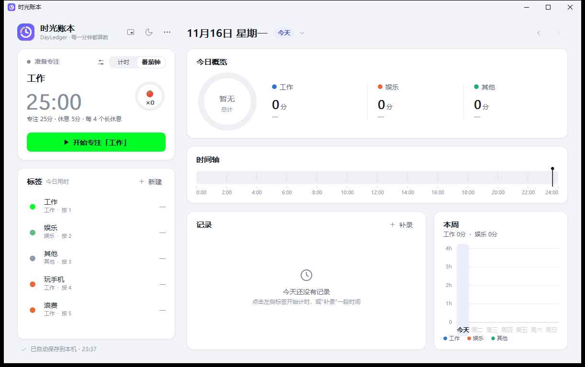

# DayLedger

An open-source native Windows time ledger: tag where your time goes each day, with a built-in Pomodoro timer. One portable exe, all data kept on your machine.

English | [简体中文](README.md)



## Features

**Time tracking**

- Click a tag to start, switch, or stop tracking; hotkeys `1`–`9` do the same
- Backfill a time range you forgot to track
- Edit or delete records, with undo (`Ctrl+Z`)
- Export records to CSV
- Prompts you how to count time away / system sleep beyond 5 minutes

**Statistics**

- Today's overview: ring chart, per-tag totals and shares, compared with the previous day
- 24-hour timeline with hover details
- Today's record list
- Weekly stacked bar chart; click a day to jump to it
- Date picker: days with records are marked, scroll to flip months

**Pomodoro**

- Two modes, 「计时 / 番茄钟」(Timer / Pomodoro), toggled with `P`
- Configurable focus, short-break, and long-break lengths, plus long-break interval
- Completed pomodoros are counted and flagged in records, the timeline, and weekly stats
- Chime, taskbar flash, and a system notification when the window is in the tray
- Pause, skip, or abandon; sleep/hibernate interrupts at the last awake moment
- Mini floating window (`M`), always-on-top, run at login

**Desktop integration**

- The close button hides to the system tray (can be disabled in the menu); the tray menu operates tracking and the Pomodoro directly
- Only one instance per data directory
- Light/dark theme, following the system or set manually
- PerMonitorV2 DPI scaling; remembers window size, position, and theme
- Stops tracking and saves when Windows shuts down

Note: the user interface is currently in Simplified Chinese only.

## Requirements

- Windows 10 / 11 (x64)
- No runtime dependencies: the build produces a single statically linked executable

## Build

Requires MinGW-w64 (g++ with C++17 support):

```sh
./build-mingw.sh
```

This produces `build/TimeTracker.exe` (about 1.5 MB). Double-click to run.

MSVC is also supported: run `build-msvc.bat` in an x64 Native Tools Command Prompt for VS 2022. The script follows the spec but could not be tested on the authoring machine; only the MinGW build was verified.

## Keyboard shortcuts

| Key | Action |
|---|---|
| `1` – `9` | Start / switch / stop the corresponding tag |
| `Space` | Stop tracking, or resume the last tag (Pomodoro: pause / resume) |
| `P` | Toggle Pomodoro mode |
| `S` / `R` | Pomodoro: skip the current phase / abandon |
| `M` | Mini floating window |
| `←` / `→` | Previous / next day |
| `Home` | Back to today |
| `Ctrl+N` | New tag |
| `Ctrl+B` | Backfill a time range |
| `Ctrl+Z` | Undo delete |
| `F1` | Show shortcut help |
| `Ctrl+Q` | Quit (after saving) |

Right-click a tag or a record for more actions.

## Data and privacy

- Data directory: `%LOCALAPPDATA%\DayLedger\`
  - `tracker.dat`: all records (TRACKER3 format; TRACKER1 / TRACKER2 files still load)
  - `settings.ini`: settings
- Everything stays on your machine; the app makes no network requests and has no telemetry
- Use「⋯ → 打开数据文件夹」(Open data folder) to locate it; delete the folder to erase all data

## Project layout

```
src/time_tracker.cpp   Main program: window, custom-drawn UI, tray, Pomodoro screens, automation interface
src/tracker_model.h    Data model, TRACKER format I/O, record editing API
src/pomodoro.h         Pomodoro state machine (pure logic, unit-testable)
src/ui_kit.h           Theme, drawing helpers, icons, Chinese formatting
src/time_tracker.rc    Icon and version resources
src/app.manifest       DPI awareness and OS compatibility
tests/                 Model / state machine tests and a desktop smoke test
build-mingw.sh         MinGW build script
build-msvc.bat         MSVC build script
```

## Tests

Model and Pomodoro state machine tests:

```sh
g++ -std=c++17 -O2 -static tests/tracker_model_test.cpp -o build/tracker_model_test.exe
./build/tracker_model_test.exe
# PASS: 230 checks
```

Desktop smoke test (needs Windows Python and an interactive desktop):

```sh
python tests/desktop_smoke.py --exe build/TimeTracker.exe
```

The smoke test drives the UI through the app's built-in `WM_COMMAND` / `WM_DL_QUERY` automation interface and redirects `LOCALAPPDATA` to a temporary directory, so it never touches real data.

## Known limitations

- The UI is Simplified Chinese only
- Windows only
- The MSVC build script has not been verified

## License

This project is licensed under the [MIT](LICENSE) license.