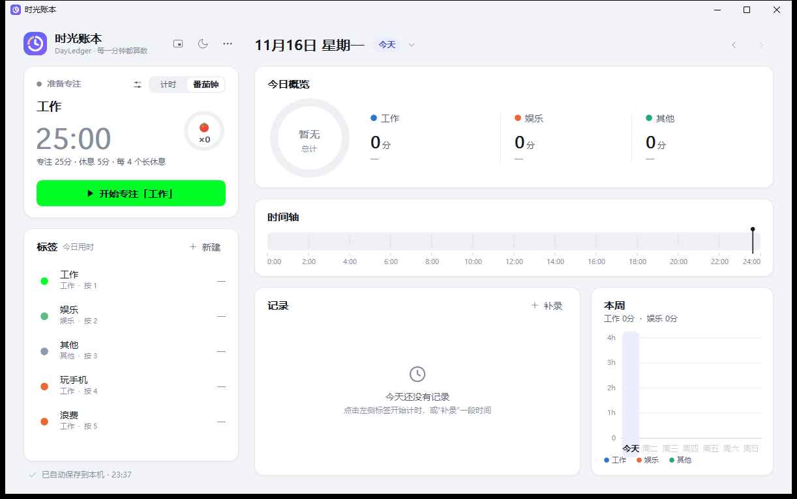

# 时光账本 DayLedger

一个开源的 Windows 原生时间账本：用标签记下每天的精力去向，并内置番茄钟。单个绿色 exe，数据全部保存在本机。

[English](README.en.md) | 简体中文



## 功能

**时间记录**

- 标签按「大类」分组（默认：工作 / 娱乐 / 其他）；大类可以新建、改名、换色、排序和删除
- 单击标签开始 / 切换 / 停止计时，也可用快捷键 `1–9`（按侧栏从上到下的顺序）
- 新标签自动取所属大类的同色系颜色（由深到浅 8 档，已用的会标出）；大类换色时，标签可以一起换成新色系
- 忘记计时时可手动补录一段时间
- 记录可编辑、删除，删除支持撤销（`Ctrl+Z`）
- 记录可导出为 CSV
- 离开或睡眠超过 5 分钟时，询问这段时间如何计入

**统计视图**

- 今日概览：双层环形图（内圈大类、外圈标签），每个大类下列出用时最多的标签，并与前一天对比
- 24 小时时间轴，悬停查看详情
- 当天记录列表
- 本周堆叠柱状图，单击某天跳转
- 日期选择器：有记录的日子带圆点，可滚轮翻月

**番茄钟**

- 「计时 / 番茄钟」双模式（`P`）
- 专注、短休息、长休息时长与长休息间隔均可设置
- 完成的番茄有计数，并标记在记录、时间轴和周报中
- 阶段结束提示音、任务栏闪烁；窗口在托盘时用系统通知提醒
- 支持暂停、跳过、放弃；睡眠或休眠时按最后清醒时刻中断
- 迷你悬浮窗（`M`）、窗口置顶、开机自启

**桌面集成**

- 自绘标题栏：日期导航、保存状态和窗口按钮合在一行，内容区更大；支持 Windows 11 贴靠布局；「⋯ → 使用系统标题栏」可切回系统样式
- 点关闭按钮收进系统托盘（可在菜单中关闭此行为）；托盘右键菜单可直接操作计时与番茄钟
- 同一数据目录只允许运行一个实例
- 浅色 / 深色主题，跟随系统或手动切换
- PerMonitorV2 DPI 缩放；记忆窗口大小、位置与主题
- 关机时自动停止计时并保存

## 系统要求

- Windows 10 / 11（x64）
- 无运行时依赖：编译产物为单个静态链接的可执行文件

## 构建

需要 MinGW-w64（g++ 支持 C++17）：

```sh
./build-mingw.sh
```

产物为 `build/TimeTracker.exe`（约 1.5 MB），双击即可运行。

也可以使用 MSVC：在 x64 Native Tools Command Prompt for VS 2022 中运行 `build-msvc.bat`。该脚本按规范编写，但未在作者机器上实际验证（仅验证过 MinGW 构建）。

## 快捷键

| 按键 | 功能 |
|---|---|
| `1` – `9` | 开始 / 切换 / 停止对应标签 |
| `空格` | 停止计时，或继续上一个标签（番茄钟：暂停 / 继续） |
| `P` | 切换番茄钟模式 |
| `S` / `R` | 番茄钟：跳过当前阶段 / 放弃 |
| `M` | 迷你悬浮窗 |
| `←` / `→` | 前一天 / 后一天 |
| `Home` | 回到今天 |
| `Ctrl+N` | 新建标签 |
| `Ctrl+B` | 补录一段时间 |
| `Ctrl+Z` | 撤销删除 |
| `F1` | 查看快捷键帮助 |
| `Ctrl+Q` | 退出（保存后退出） |

右键单击大类、标签或记录可以看到更多操作（例如把标签移到另一个大类）。

## 数据与隐私

- 数据目录：`%LOCALAPPDATA%\DayLedger\`
  - `tracker.dat`：全部记录（TRACKER4 格式，含大类表；仍可读取 TRACKER1–3。升级后保存过的文件，旧版程序无法再打开）
  - `settings.ini`：设置
- 所有数据只保存在本机，程序不联网、无遥测
- 「⋯ → 打开数据文件夹」可直接定位；删除该文件夹即可清空全部数据

## 项目结构

```
src/time_tracker.cpp   主程序：窗口、自绘 UI、托盘、番茄钟界面与自动化接口
src/tracker_model.h    数据模型、TRACKER 格式读写、记录编辑 API
src/pomodoro.h         番茄钟状态机（纯逻辑，可单测）
src/ui_kit.h           主题、绘图工具、图标与中文格式化
src/time_tracker.rc    图标与版本资源
src/app.manifest       DPI 感知与系统兼容性声明
tests/                 数据层 / 状态机测试与桌面冒烟测试
build-mingw.sh         MinGW 构建脚本
build-msvc.bat         MSVC 构建脚本
```

## 测试

数据层与番茄状态机测试：

```sh
g++ -std=c++17 -O2 -static tests/tracker_model_test.cpp -o build/tracker_model_test.exe
./build/tracker_model_test.exe
# PASS: 271 checks
```

桌面冒烟测试（需要 Windows Python 和交互式桌面）：

```sh
python tests/desktop_smoke.py --exe build/TimeTracker.exe
```

冒烟测试通过程序内建的 `WM_COMMAND` / `WM_DL_QUERY` 自动化接口驱动界面，并把 `LOCALAPPDATA` 临时重定向到隔离目录，不会影响真实数据。

## 已知限制

- 界面目前仅提供简体中文
- 仅支持 Windows
- MSVC 构建脚本未实测

## 许可证

本项目采用 [MIT](LICENSE) 许可证。